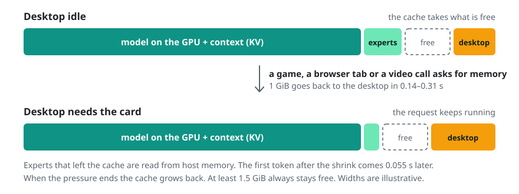
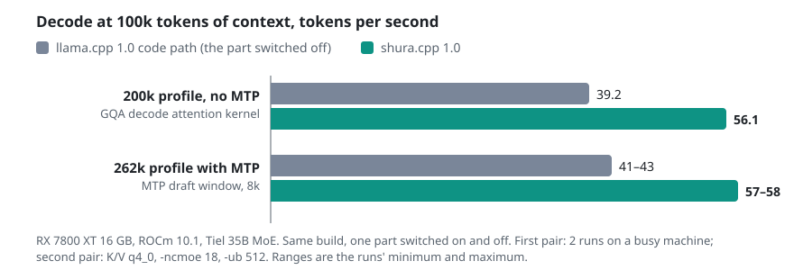

<h1 align="center">
  
</h1>

<p align="center">
  <b>The inference engine of <a href="https://github.com/hikkian/shura">Shura</a>.</b><br>
  A large MoE model on one consumer GPU, next to a desktop that needs the same card.
</p>

<p align="center">
  <a href="#what-it-adds-to-llamacpp-10">What it adds</a> |
  <a href="#measurements">Measurements</a> |
  <a href="#quick-start">Quick start</a> |
  <a href="#limits">Limits</a> |
  <a href="docs/SHURA.md">Full list of differences</a>
</p>

---

**shura.cpp 1.0 is [llama.cpp](https://github.com/ggml-org/llama.cpp) v1.0.0 plus only the parts upstream does not have**, added on top
of upstream's own mechanisms wherever one exists. Upstream's expert cache, MTP drafting, rotated KV quantization and direct-I/O loader
are used as they are. Everything below is what sits on top.

The problem it solves: a 35B mixture-of-experts model does not fit into 16 GB of VRAM, so part of its experts lives in host memory and
a cache of the hot ones lives on the card. On a desktop that cache competes with the browser, the compositor and games. shura.cpp lets
the cache take the memory nobody uses and hand it back within a fraction of a second when somebody asks.

<p align="center">
  
</p>

## What it adds to llama.cpp 1.0

**Sharing the card**

- **Live resize of upstream's expert cache.** The cache changes size while the server runs. A failed allocation rolls back to the
  previous size; a second failure leaves the cache empty and the server keeps answering from host memory. New slots are warmed from
  the use counters, so speed does not dip after a grow.
- **VRAM governor.** Watches free VRAM, grows the cache into it and gives it back when the desktop needs the card. Endpoints:
  `/vram`, `/vram/policy`, `/vram/pause`, `/vram/journal`.
- **Abort inside a CUDA/HIP graph.** A long graph can be interrupted between nodes and between micro-batches, so memory is released
  without waiting for a whole batch. Models with recurrent or hybrid memory are never interrupted mid-batch: their state cannot be
  rolled back over a slice.
- **Pause and resume.** A request can be parked with its slot and continued later; restoring a slot takes 52–60 ms. `/slots` reports
  an estimate of the slot size, so a client can decide where to keep it.

**Long context on 16 GB**

- **The full 262 144-token context with MTP drafting on.** One profile, measured at 100k tokens: prefill about 1290 tok/s, decode
  about 59 tok/s; at 200k: 910 and 45 tok/s; at 243k: 770 and 35 tok/s, with at least 1.7 GiB of VRAM still free.
- **KV on GPU virtual memory** (`SHURA_KV_VMM=1`, HIP). The KV cache takes VRAM as the conversation grows; what a shorter
  conversation does not use goes to the expert cache. If the card has no memory for the next step, the expert cache gives it back,
  and if that is not enough the server pauses and saves the slot instead of failing the request.
- **MTP draft window** (`SHURA_MTP_WINDOW=N`). The draft head attends only to the last N positions. The target model still verifies
  every token, so what gets accepted does not depend on the window. The draft's KV at 262k shrinks from 1088 MiB to 109 MiB.
- **GQA-vectorised decode attention** (HIP) for K and V in `q8_0`, `q4_0` and `q5_0`, including the 3-token MTP verify batch.

**Speed parts**

- **Expert upload overlap**: a large-batch expert tensor is uploaded while the previous split still computes.
- **A fix for prefill attention at depth**: in v1.0.0 the WMMA kernel receives its KV-rows pointer as a run-time value, which keeps a
  gather branch in the inner loop. With a literal `nullptr` when there are no rows the kernel is about 24 % faster at 100k tokens.

**Thinking and diagnostics**

- **Soft reasoning budget**: a soft target and a soft ceiling for reasoning tokens, with counters and a shadow mode. Off by default;
  without the new request fields the output is upstream's.
- **Diagnostics**: stacks of all threads on an abort, failure context for GPU page faults, a limit for pinned host memory,
  allocation logging.
- **Streaming KL divergence** in `llama-perplexity` (`SHURA_PPL_STREAM=1`): memory no longer grows with the context length.

The complete table, with the files each part touches: [docs/SHURA.md](docs/SHURA.md).

## Measurements

All numbers are our own, from one machine: **RX 7800 XT 16 GB, ROCm 10.1, Ryzen 5 5600, 32 GB RAM, Linux**, model **Tiel 35B-A3B MoE**
(a 14 GiB GGUF), `--load-mode dio`. Pairs alternate between the two sides on a quiet machine unless noted.
"llama.cpp 1.0 code path" means the same build with that one part switched off.

<p align="center">
  
</p>

| What | llama.cpp 1.0 code path | shura.cpp 1.0 | Conditions |
|---|---|---|---|
| Decode at 100k tokens, no MTP | 39.2 tok/s | **56.1 tok/s** | 200k profile; GQA kernel off / on; 2 pairs, machine was busy |
| Decode at 100k tokens, MTP on | 41–43 tok/s | **57–58 tok/s** | 262k profile, K/V `q4_0`; draft window off / 8k |
| MTP draft KV at 262k | 1088 MiB | **109 MiB** | memory breakdown; draft window 8k |
| Prefill attention kernel at 100k | 44.5 s per 1000 calls | **36.0 s** | WMMA, head size 256; rocprof |
| Prefill at 28k | 14.8 % slower than our earlier engine | **on par with it** (−1.1 % … +2.9 %) | expert upload overlap off / on |
| 1 GiB of VRAM back to the desktop | no governor | **0.14–0.31 s** | 6 pairs, cache shrinks under pressure |
| First token after the cache shrinks | no governor | **0.054–0.058 s** | same runs |
| Our parts with the governor off | baseline | short decode +2.3 % [−1.2; +5.0], 28k unchanged | 3 pairs, equal cache size: the additions cost nothing |

The 262k profile uses K/V `q5_0`. Its KL divergence against f16 KV is 0.0078 at 16k tokens of context; `q8_0` gives 0.0067 and `q4_0`
0.0128 in the same test.

Against our earlier engine (the `shura` branch) in the everyday 32k profile: short decode +6.8 %, decode at 28k +11.5 %, prefill at 28k
+2.9 %, 276 MiB less process memory.

**What these numbers are not.** They are speed and memory on one card and one model. Answer quality was not part of these runs.
Other GPUs, other models and other drivers will give other numbers.

## Quick start

AMD (ROCm / HIP). Set `GPU_TARGETS` to your card; `gfx1101` is the RX 7800 XT.

```bash
cmake -S . -B build -G Ninja -DCMAKE_BUILD_TYPE=Release -DGGML_HIP=ON -DGPU_TARGETS=gfx1101 -DLLAMA_CURL=OFF \
      -DGGML_CUDA_FA_QUANTS="q8_0-q8_0;q8_0-q4_0;q4_0-q4_0;q4_0-q8_0;q5_0-q5_0;q5_0-q4_0;f16-f16;bf16-bf16"
cmake --build build --target llama-server
```

NVIDIA (CUDA):

```bash
cmake -S . -B build -G Ninja -DCMAKE_BUILD_TYPE=Release -DGGML_CUDA=ON -DCMAKE_CUDA_ARCHITECTURES=<arch> -DLLAMA_CURL=OFF \
      -DGGML_CUDA_FA_QUANTS="q8_0-q8_0;q8_0-q4_0;q4_0-q4_0;q4_0-q8_0;q5_0-q5_0;q5_0-q4_0;f16-f16;bf16-bf16"
cmake --build build --target llama-server
```

Run, everyday 32k profile with MTP and the governor (the settings we use on the machine above):

```bash
GGML_SCHED_PREFETCH_EXPERTS=3 GGML_HIP_FA_GQA_VEC=1 GPU_MAX_HW_QUEUES=2 \
build/bin/llama-server -m model.gguf -c 32768 -ub 1024 -ncmoe 14 -ctk q8_0 -ctv q4_0 -fa on --load-mode dio \
  --spec-type draft-mtp --spec-draft-n-max 2 --spec-draft-p-min 0.25 -ctkd q8_0 -ctvd q8_0 \
  --moe-cache-live-resize --moe-cache-mib 0 --moe-cache-cpu-share 0.5 --vram-governor
```

The full 262 144 context with MTP: the same line with `-c 262144 -ncmoe 18 -ub 1024 -ctk q5_0 -ctv q5_0 --vram-buffer-mib 512` and `SHURA_MTP_WINDOW=8192 SHURA_KV_VMM=1` (KV on GPU virtual memory: it takes VRAM as the conversation grows, the rest goes to the expert cache)
in the environment. `-ncmoe` is the number of layers whose experts stay in host memory; it depends on the model and the card.
`GGML_HIP_FA_GQA_VEC` has an effect on HIP only.

```bash
curl -s localhost:8080/vram          # what the governor sees and what it did
curl -s localhost:8080/vram/policy   # its thresholds
```

If you want the whole thing (a gateway that picks the profile, pauses for games and keeps the desktop responsive, plus a coding
agent), that is [Shura](https://github.com/hikkian/shura). shura.cpp is its engine and works on its own.

## Limits

- **Measured on AMD only.** The CUDA build has a CI job that compiles it; we have not run or measured it ourselves.
- **The VRAM governor needs amdgpu's sysfs.** On NVIDIA it reports itself unavailable and the server runs without it.
- **The GQA decode kernel is HIP only** and covers K/V `q8_0`, `q4_0`, `q5_0`. Other KV types use upstream's per-head kernel, which
  was 25–35 % slower in decode at 100k tokens in our runs.
- **`SHURA_MTP_WINDOW` changes what the draft sees, never what the target accepts.** With temperature above 0 a different acceptance
  pattern still gives a different, equally valid sample than a run without the window.
- **MTP acceptance** is about 1.7 points lower than our earlier engine's at `--spec-draft-p-min 0.2`; `0.25` brings it back.
- **Upstream v1.0.0**: `PAD_REFLECT_1D` fails in `test-backend-ops` on HIP gfx1101, and `iq4_nl` KV has no flash-attention kernel on
  CUDA/HIP. Neither is used by the models we run.
- **TurboQuant KV types of our earlier versions are gone.** Upstream's rotated `q4_0` was at least as accurate in our test, so model
  files and slot saves that use the old TurboQuant types are not read by 1.0.

## Documentation

- [docs/SHURA.md](docs/SHURA.md): every difference from upstream, recommended settings, known limits.
- [docs/SHURA-UPDATE.md](docs/SHURA-UPDATE.md): how to move to a newer llama.cpp. The hook points into upstream files are listed in
  [touchpoints.toml](touchpoints.toml) and checked by `scripts/shura-touchpoints.py`.
- [docs/UPSTREAM-README.md](docs/UPSTREAM-README.md): llama.cpp's own README, unchanged.

## Thanks

shura.cpp exists because of **[llama.cpp](https://github.com/ggml-org/llama.cpp)** and the ggml authors: the engine, the MoE expert
cache, MTP drafting and the KV rotation are theirs. The earlier versions of this fork started from
**[thecodacus/llama.cpp](https://github.com/thecodacus/llama.cpp)** by Anirban Kar and used the TurboQuant KV types from
**[TheTom/llama-cpp-turboquant](https://github.com/TheTom/llama-cpp-turboquant)**; their work is in the history of the `shura` branch.
Sources and licenses in detail: [NOTICE](NOTICE).

## License

MIT, as llama.cpp. See [LICENSE](LICENSE) and [NOTICE](NOTICE).
